# zmk-config-roBa

Windows・US配列・Microsoft IME向けのキーマップです。日本語文章、TypeScript / JavaScript、Markdown、シェル入力を想定しています。roBa v2、トラックボールあり、ロータリーエンコーダーなしの構成で使います。

## 基本操作

文字はQWERTYです。文字キーの長押し兼用と同時押しコンボは使いません。

通常レイヤーのLの右隣は`-`です。Shiftとの組み合わせで`_`を入力できます。引用符`'`と`"`はSYMのF/G位置にあります。

親指キーは、キーボードを上から見て左から次の順序です。SpaceとEnterは専用キーです。

| 位置 | 短押し | 200 ms以上の長押し |
| --- | --- | --- |
| 左・外側 | IME OFF | NUM（数字） |
| 左・中央 | Space | Space |
| 左・内側 | IME ON | SYM（記号） |
| 右・内側 | Backspace | NAV（移動） |
| 右・外側 | Enter | Enter |

長押し中だけレイヤーが有効になります。短押し優先の判定なので、レイヤーのキーは親指キーを200 ms以上押してから入力します。長押しではIME切替やBackspaceを送りません。

左下の3キーは左からCtrl・Win・Altです。左手の内側は上がTab、下がShift、右手の内側は上がEsc、下がスクロールキーです。右下端はDeleteです。Shift + TabやCtrl + Cなどは専用修飾キーと組み合わせます。

## 記号と数字

SYMは左・内側の親指キーを長押しして使います。各行は文字キーの上段・中段・下段に対応します。

| 段 | 左手：左から順 | 右手：左から順 |
| --- | --- | --- |
| 上段 | `!`　`@`　`#`　`$`　`%` | `^`　`&`　`*`　`(`　`)` |
| 中段 | `` ` ``　`;`　`:`　`'`　`"` | `-`　`=`　`[`　`]`　`\` |
| 下段 | `~`　`<`　`>`　`/`　`?` | `_`　`+`　`{`　`}`　`\|` |

[CorneのQMK標準キーマップ](https://github.com/qmk/qmk_firmware/blob/f5db962110615fd263c3ebf9f0402e7c2b08fbe4/keyboards/crkbd/keymaps/default/keymap.c)を参考にした、roBaの5列向けの配置です。上段はNUMの`1`〜`0`をUS配列でShift入力した記号と同じ位置になります。右手の中段・下段は`-/_`、`=/+`、`[/{`、`]/}`、`\`と`|`が上下で対応します。

Corneの右手6列目にあるバッククォートとチルダは、左手のA/Z位置へ移しました。その他の左手の空きにはセミコロン・コロン、引用符、比較記号などを配置しています。Corne標準の完全コピーではなく、左親指によるSYM呼び出しや専用Space・EnterはこのroBa設定を維持します。比較の経緯は[調査メモ](docs/research/2026-10-31-symbol-layout-comparison.md)を参照してください。

NUMは左・外側の親指キーを長押しして使います。最上段は左から `1 2 3 4 5 | 6 7 8 9 0` です。テンキーのキーコードは使いません。

すべてのレイヤーでSpace・Enterと親指のBackspace／NAV操作を使えます。NUM・NAV・FN・SYSの文字領域で未割り当てのキーは何も送りません。

## 移動

右親指のBackspaceを長押しするとNAVになります。

| 通常の位置 | NAVでの動作 |
| --- | --- |
| W / A / S / D | ↑ / ← / ↓ / → |
| Q / E | Home / End |
| R / F | Page Up / Page Down |
| T / G | Ctrl + Home / Ctrl + End |
| X / V | Ctrl + ← / Ctrl + → |
| C / B | Delete / Ctrl + Backspace |

Shiftを併用すると範囲選択できます。

## トラックボール

ボールを動かすとMOUSEが自動で有効になり、通常のJ / K / Lが左／中央／右クリックになります。停止後700 msで解除されます。自動切替はZMK標準の[Temporary Layer Input Processor](https://v0-3-branch.zmk.dev/docs/keymaps/input-processors/temp-layer)を使い、`config/roBa.keymap`の`&zip_temp_layer MOUSE 700`で対象レイヤーとタイムアウトを設定します。ドライバー側の`automouse-layer`は`0`で無効にしています。

キー入力後300 ms以内は、ボールから入力が届いてもMOUSEを新たに有効にしません。有効中に通常キーを押すとMOUSEを解除しますが、J / K / L、Shift、スクロール、Ctrl / Win / Altは解除対象から除外しています。除外キーを押しても700 msのタイムアウトは延長されません。これらは`&zip_temp_layer`の`require-prior-idle-ms`と`excluded-positions`で設定しています。

右手・内側下のスクロールキーを押しながらボールを動かすとスクロールします。記号・数字・移動などの手動レイヤーはMOUSEより優先され、スクロールは最優先です。

## Fキーと接続設定

- NUMを長押ししながら右手・内側上（通常Esc）も押し続けるとFNです。最上段がF1〜F10、通常のA / SがF11 / F12になります。
- NUMを長押ししながら左手・内側上（通常Tab）も押し続けるとSYSです。通常のY / U / I / O / PでBluetoothプロファイル0〜4を選択します。
- SYSで右下端のDeleteを押すと、選択中プロファイルのペアリング情報を消去します。
- SYSで右手・内側下（通常スクロール）を押すと、右側のブートローダーへ入ります。

## WindowsとMicrosoft IME

Windows側のハードウェアキーボードレイアウトは英語（US、101/102キー）にし、日本語入力にはMicrosoft IMEを使います。記号はUS配列を前提にしています。

IME OFFは`LANG2`、IME ONは`LANG1`を送ります。これはMicrosoftが定義する専用のIME OFF／ONキーです。「無変換／変換」をIME切替に再割り当てする方式ではありません。対応WindowsとMicrosoft IMEで、OFFは半角英数、ONはひらがな入力にします。

参考：[MicrosoftのIME ON／OFFキー仕様](https://learn.microsoft.com/en-us/windows-hardware/design/component-guidelines/keyboard-japan-ime)。実機では、IME OFFを繰り返しても英数、IME ONを繰り返してもひらがなになることを確認してください。

## 設定の反映

設定の正本は[`config/roBa.keymap`](config/roBa.keymap)です。GitHub Actionsのビルド後に、対応するUF2を書き込みます。今回の変更では右側のキーマップを更新します。通常のキーマップ変更でペアリング情報を初期化する必要はありません。

ビルド・書き込みの手順は[ファームウェアのビルド](docs/build.md)を参照してください。エンコーダーなしの設定は左右に含まれるため、このハードウェア設定も反映する場合は左右それぞれのUF2を書き込みます。

ZMK Studioで編集した保存済みキーマップがある場合、書き込み後にStudioの「Restore Stock Settings」でファイル側の配列に戻してください。Studio側の編集内容は失われます。参考：[ZMK Studio](https://zmk.dev/docs/features/studio)。

書き込み後は、メモ帳などでSpace・Enter、親指の短押しと長押し、`1`〜`0`、記号30種類、矢印と範囲選択、ボールのクリック／スクロールを確認してください。
